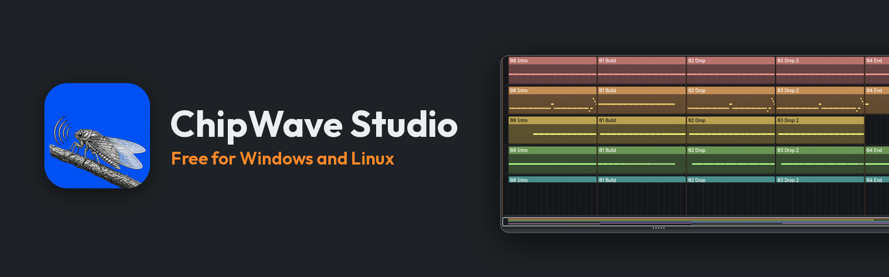

# chipwavestudio.com

The website for **ChipWave Studio** — a plain static site, no build step, no framework.
Live at **[chipwavestudio.com](https://chipwavestudio.com/)**, published by Netlify.

```
public/            the whole site (this is what gets published)
  index.html       the landing page
  assets/site.css  styles
  assets/site.js   menu, lightbox, reveal animations
  assets/shots/    screenshots converted to WebP (1600 and 800 wide)
  assets/marketing/ composed artwork (the collage), also WebP
  assets/video/    the promo film, served from this site
  assets/fonts/    Atkinson Hyperlegible Next + Mono (OFL 1.1)
  manual/          the user manual: the PDF plus index.html, the reader page
  404.html  robots.txt  sitemap.xml
media-src/         the original marketing artwork and the cicada engraving the site uses
tools/
  build_images.py     rebuilds assets/shots, assets/marketing, icons and the social image
  deploy_netlify.py   creates/updates the Netlify site and attaches the domain
netlify.toml       publish dir and redirect shortcuts (headers live in public/_headers)
```

## Rebuild the pictures

The screenshots come straight from the app repository (no mockups). After a new
ChipWave release:

```powershell
python tools/build_images.py ..\ChipWaveStudio
```

It writes `assets/shots/*.webp`, the icon sizes and `assets/og-image.jpg`.
Add or remove shots in `SHOT_SET` at the top of the script.

## Preview locally

```powershell
python -m http.server 8787 --directory public
```

Then open http://127.0.0.1:8787/ . Append `?nolazy=1` to load every image at once
(handy for full-page screenshots).

## Deploy

```powershell
$env:NETLIFY_AUTH_TOKEN = "<token>"
python tools/deploy_netlify.py --site chipwavestudio --domain chipwavestudio.com
```

The script zips `public/`, creates the site if it does not exist, uploads the
deploy, waits for it to go live and sets the custom domain. Never commit the token.

If Netlify is ever switched to building from this repository instead, the settings
are: publish directory `public`, no build command, and `netlify.toml` at the root.
The 62 MB promo must stay in the repository for the video to survive a git build.

### DNS

The domain is registered at Cloudflare, so point it at Netlify in the Cloudflare
dashboard (DNS → Records). Netlify gives the exact target host after the first
deploy; in short:

| Type | Name | Target | Proxy |
|---|---|---|---|
| CNAME | `@` (chipwavestudio.com) | `<site>.netlify.app` | DNS only |
| CNAME | `www` | `<site>.netlify.app` | DNS only |

Cloudflare flattens the apex CNAME, so no ALIAS record is needed. Keep both
records on **DNS only**: Netlify issues the HTTPS certificate itself, and proxying
stops it.

## Content notes

- Version, download URLs, sizes and the “new in” section are for **0.2.17.0**.
  Download links use `releases/latest/download/...`, so they follow new releases;
  the version text and the new-in cards need a manual edit per release.
- Every claim on the page comes from the app's README, docs and source
  (the themes, for example, are `SLATE`, `DARK` and `AMIGA` in `src/theme.rs` —
  Slate is the default, and the page used to say there were only two).
- Pictures are real captures; keep it that way.
- The user manual lives in `public/manual/`. To publish a new one, drop the PDF in there,
  render page 1 as a PNG into `media-src/manual-cover.png` (Windows PowerShell can do it
  with `Windows.Data.Pdf`, see the commit log), rebuild the cover WebPs and update the
  page count, file size and version on the home page and in `manual/index.html`.
- The cicada in the header, footer, hero and social card is `media-src/cicada-source.png`, re-inked by `build_images.py` into white line art for the dark page.
- The promo in `public/assets/video/` is the 62 MB MP4 from the media
  folder. It is committed so every deploy carries it; `preload="none"` means a
  visitor only downloads it after pressing play. Compress it before swapping in a
  longer video, and keep `poster="/assets/shots/promo-960.webp"`.
- The other artwork in the media folder (captioned `feature-*.png`, `hero-1920`,
  `banner`, `og-image`) is deliberately not used: the captions duplicate this
  page and some are out of date (16-pad drum kit, "Windows and Linux"), while the
  raw captures are sharper. `hero-1920` and `banner-1600x500` are good for the
  GitHub repo and social cards.

## Licence

The site text and layout belong to the project (GPL-3.0-or-later, like ChipWave
Studio). The fonts are under the SIL Open Font License 1.1 — see
`public/assets/LICENSE-AtkinsonHyperlegible.txt`.
